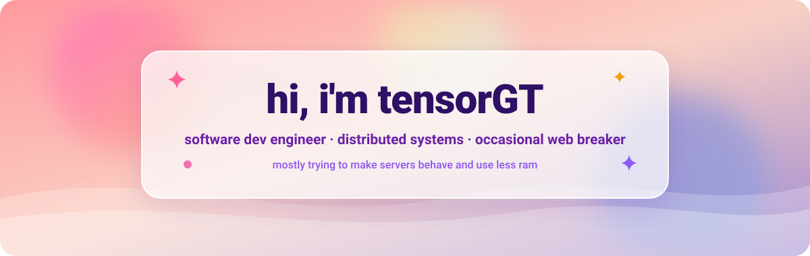
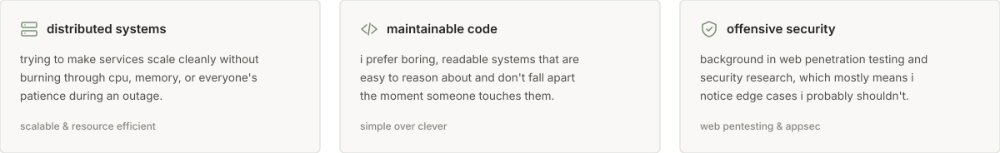

  

  

---

### tools &amp; languages

  
  
  
  
  
  

  
  
  
  
  
  

  
  
  

---

### projects

<table>
  <tr>
    <td width="50%" valign="top">
      <a href="https://github.com/tensorGT/safeAuth"><strong>safeAuth</strong></a> 
      zero-password auth in go with 128-bit bip39 seeds, per-origin ed25519 keys, and an encrypted local vault.
    </td>
    <td width="50%" valign="top">
      <a href="https://github.com/tensorGT/scannex"><strong>scannex</strong></a> 
      fast windows storage scanner written in rust for indexing drives and media libraries.
    </td>
  </tr>
  <tr>
    <td width="50%" valign="top">
      <a href="https://github.com/tensorGT/greg"><strong>greg</strong></a> 
      fast local ai background remover and image pipeline with cli, browser ui, ndjson streaming, and mcp server.
    </td>
    <td width="50%" valign="top">
      <a href="https://github.com/tensorGT/fastapi-webhook-reconcile"><strong>fastapi-webhook-reconcile</strong></a> 
      hmac-signed webhook ingestion, idempotency deduplication, and ledger reconciliation in fastapi + sqlite.
    </td>
  </tr>
  <tr>
    <td width="50%" valign="top">
      <a href="https://github.com/tensorGT/async-http-header-check"><strong>async-http-header-check</strong></a> 
      rate-limited async http security header, cors, and open-redirect auditor built with asyncio and httpx.
    </td>
    <td width="50%" valign="top">
      <a href="https://github.com/tensorGT/local-port-tls-checker"><strong>local-port-tls-checker</strong></a> 
      allowlist-guarded local port scanner, banner grabber, and tls certificate/cipher inspector in python.
    </td>
  </tr>
  <tr>
    <td width="50%" valign="top">
      <a href="https://github.com/tensorGT/playwright-checkpoint-runner"><strong>playwright-checkpoint-runner</strong></a> 
      resilient headless browser + api workflow runner with step checkpoints and failure snapshots.
    </td>
    <td width="50%" valign="top">
      <a href="https://github.com/tensorGT?tab=repositories"><strong>all repositories &rarr;</strong></a> 
      browse the rest of my public repos.
    </td>
  </tr>
</table>

---

### stats

  
  

  <picture>
    <source media="(prefers-color-scheme: dark)" srcset="https://raw.githubusercontent.com/tensorGT/tensorGT/output/github-contribution-grid-snake-dark.svg" />
    <source media="(prefers-color-scheme: light)" srcset="https://raw.githubusercontent.com/tensorGT/tensorGT/output/github-contribution-grid-snake.svg" />
    
  </picture>

