  

  

  
  
  

---

### Security Research & Offensive Arsenal

  

  
  
  
  
  

---

### Tech Stack & Infrastructure

  
  
  
  
  

  
  
  
  
  
  

---

### Featured Projects

<table>
  <tr>
    <td width="50%" valign="top">
      <a href="https://github.com/tensorGT/safeAuth"><strong>safeAuth</strong></a> 
      Zero-password, local-first auth in Go rooted in a 128-bit BIP39 seed, per-origin Ed25519 keys, Argon2id vault &amp; 1-of-N Schnorr ring proofs.
    </td>
    <td width="50%" valign="top">
      <a href="#"><strong>Project Alpha — Lorem Ipsum</strong></a> 
      Lorem ipsum dolor sit amet, consectetur adipiscing elit. Sed do eiusmod tempor incididunt ut labore et dolore magna aliqua.
    </td>
  </tr>
  <tr>
    <td width="50%" valign="top">
      <a href="#"><strong>Project Beta — Lorem Ipsum</strong></a> 
      Ut enim ad minim veniam, quis nostrud exercitation ullamco laboris nisi ut aliquip ex ea commodo consequat.
    </td>
    <td width="50%" valign="top">
      <a href="#"><strong>Project Gamma — Lorem Ipsum</strong></a> 
      Duis aute irure dolor in reprehenderit in voluptate velit esse cillum dolore eu fugiat nulla pariatur.
    </td>
  </tr>
  <tr>
    <td width="50%" valign="top">
      <a href="#"><strong>Project Delta — Lorem Ipsum</strong></a> 
      Excepteur sint occaecat cupidatat non proident, sunt in culpa qui officia deserunt mollit anim id est laborum.
    </td>
    <td width="50%" valign="top">
      <a href="#"><strong>Project Epsilon — Lorem Ipsum</strong></a> 
      Curabitur pretium tincidunt lacus. Nulla gravida orci a odio. Nullam varius, turpis et commodo pharetra.
    </td>
  </tr>
  <tr>
    <td width="50%" valign="top">
      <a href="#"><strong>Project Zeta — Lorem Ipsum</strong></a> 
      Maecenas malesuada. Praesent congue erat at massa. Sed cursus turpis vitae tortor. Donec posuere vulputate arcu.
    </td>
    <td width="50%" valign="top">
      <a href="#"><strong>More on GitHub &rarr;</strong></a> 
      Explore all repositories, security advisories, and research notes.
    </td>
  </tr>
</table>

---

### GitHub Telemetry

  
  

  

---

### Contribution Snake

  <picture>
    <source media="(prefers-color-scheme: dark)" srcset="https://raw.githubusercontent.com/tensorGT/tensorGT/output/github-contribution-grid-snake-dark.svg" />
    <source media="(prefers-color-scheme: light)" srcset="https://raw.githubusercontent.com/tensorGT/tensorGT/output/github-contribution-grid-snake.svg" />
    
  </picture>

